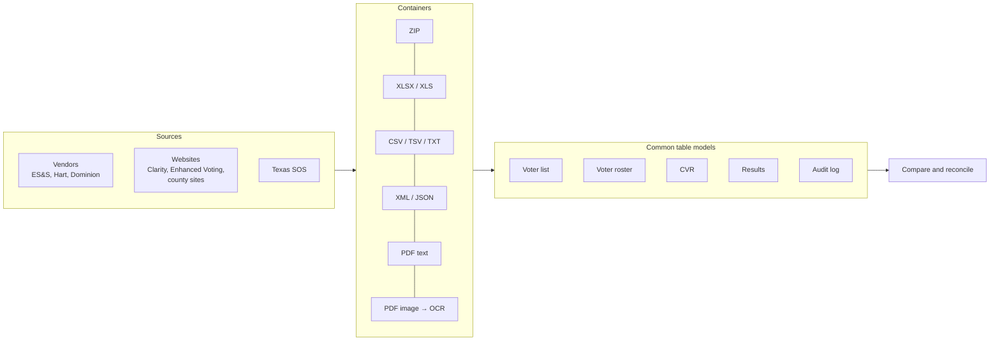

# Election Data Formats

How U.S. election records are actually stored and published, with the Election Explorer code
base and its data collection as the worked example.

> **Who this is for:** anyone who wants to check election records themselves: auditors, poll
> watchers, journalists, researchers, election officials, and developers. It explains why the
> data is hard to work with before any analysis can begin, and what each kind of record looks
> like in practice.

---

## Summary

**There is no standard format for election records.** Election law says *what* a record must
contain, such as a roster of who voted, the results by precinct, or an audit log, but almost
never *how* it is stored. Each record therefore takes the shape of the voting system that made
it, the software version, the county's website, and the habits of the people who print, edit
and post it.

Election Explorer reads five kinds of election records:

| Record | What it answers | Who makes it | Formats seen in this collection |
|---|---|---|---|
| **Voter registration list** | Who is registered, where, in which districts | County voter registrar; state voter database | CSV, tab-delimited TXT, XLSX; dozens to hundreds of columns |
| **Voter roster** | Who has voted, how and when | County election office, daily during voting; Secretary of State | XLSX, CSV, TSV, PDF, ZIP of any of these; daily or cumulative |
| **Cast vote record (CVR)** | What each ballot recorded, contest by contest | The voting system (ES&S, Hart, Dominion) | XLSX/CSV/TSV (ES&S); ZIP of XML per sheet, text PDF, scanned PDF (Hart); ZIP of JSON (Dominion) |
| **Election results** | The vote totals, by precinct and vote type | The voting system's reporting; results websites | Clarity CSV / fixed-width TXT / XLS / XLSX / XML; ES&S, Hart and Dominion PDF reports; scanned PDFs |
| **Audit log** | What was done to the election system, by whom, when | The election management system (EMS) and its components | Text PDFs (ES&S JasperReports, Hart Reporting Services), sometimes with a digital signature |

The same facts usually exist in more than one record, and in more than one format. One
election's ballot count can be checked five ways: the audit log's batch loads, the CVR's rows,
the results' "ballots cast", the rosters' voters, and the registration list's voting history.
Taken together, the records check one another. That is the purpose of Election Explorer: read
each record whatever its format, put it in one common table model, and compare it with the
others.

The varied formats come from five sources. Each is described below.

1. **Vendors.** ES&S, Hart InterCivic and Dominion (now Liberty Vote) each export CVRs, results
   and logs in different structures, and the structure changes between software versions.
2. **Publishing platforms.** Results websites (Clarity Elections, Enhanced Voting) and county
   content-management systems each package the files their own way.
3. **Printing.** Much of the record is published as a **PDF printed from a report**, not as
   data. Reading it back means rebuilding tables from positioned text, or from page images by
   OCR.
4. **People.** Files are renamed, retyped, misdated, edited in Acrobat, redacted with different
   tools, or posted twice.
5. **Time.** A record is a snapshot. The roster on day 3 of early voting, the election-night
   results and the final canvass are different files that report different numbers for the
   same election.

Election Explorer reads most of the formats described here. Each one was validated against the
county's official results, usually to the exact vote. Formats it does not read yet are noted
where they come up.

---

## Contents

1. [The data collection](#1-the-data-collection)
2. [Why the formats vary](#2-why-the-formats-vary)
3. [Voter registration lists](#3-voter-registration-lists)
4. [Voter rosters](#4-voter-rosters-who-has-voted)
5. [Cast vote records](#5-cast-vote-records-cvrs)
6. [Election results](#6-election-results)
7. [Audit logs](#7-audit-logs)
8. [Other election records](#8-other-election-records)
9. [Problems common to every record type](#9-problems-common-to-every-record-type)
10. [How Election Explorer reads them](#10-how-election-explorer-reads-them)
11. [Further reading](#11-further-reading)

---

## 1. The data collection

The examples in this document come from public records collected while Election Explorer was
being built. Most of them are from Texas counties; there are also records from California,
Georgia and Illinois. The collection is not part of this repository: it is far too large for
GitHub, and it contains voter records.

### Volume

On 2026-10-30 the collection held about **48 GB in 6,400 files**:

| Record type | Size | Files | Main file types | Counties |
|---|---:|---:|---|---|
| Cast vote records | 18 GB | 144 | XLSX 52, PDF 48, ZIP 44 | 20: San Francisco and Sierra (CA), DeKalb (IL), 17 in Texas |
| Voter registration lists | 21 GB | 66 | CSV 52, TXT 11, XLSX 3 | Travis, Dallas, El Paso |
| Voter rosters | 4.1 GB | 2,505 | CSV 1,036, XLSX 674, ZIP 418, PDF 355, XLS 22 | 50 Texas counties, plus the Texas SOS |
| Election results | 5.0 GB | 3,603 | ZIP 1,944, PDF 1,619, XML 12, XLSX 12, CSV, HTML, TXT | 47 Texas counties, San Francisco and Sierra (CA), DeKalb (GA) |
| Audit logs | 394 MB | 90 | PDF 89, ZIP 1 | Travis, Dallas, Parker, Hays, Burnet |

The audit logs are 70 ES&S Electionware audit event reports (about 1.88 million events) and 19
Hart Verity Audit Log Reports.

Individual files are large. A Tarrant County CVR is a single 2.2 GB ZIP holding 828,544 XML
files. Its PDF version is 3.7 GB and 1.65 million pages. San Francisco's November 2024 CVR is
5.0 GB of JSON in 27,554 files. One Dallas County registration list is 522 MB.

### File naming

Counties name files however they like, so the collection adds an **election code** prefix and
keeps the county's own name after it (`G24_detailxml.zip`, `P26 CVR-Dem.zip`):

| Code | Election |
|---|---|
| `P26` | March primary (2026) |
| `PR26` | Primary runoff |
| `L26` | May uniform (local) election |
| `LR26` | Runoff of the May election |
| `G25` | November general or constitutional amendment election |
| `GR25` | December runoff of the November election |
| `S26_0131` | Any other date (special elections): year, then month and day |

The county's own file name is kept because it is evidence, but it is not trusted. Dallas's
`G24_Final Election Audit Log.pdf` is an *Admin* log, not the election log. A Travis
`03.05.2024 Early Vote.xlsx` is actually the Election Day roster. Election Explorer identifies
every file **by its content**.

---

## 2. Why the formats vary

### The law sets the content, not the format

Texas is typical. Election Code §87.121 requires a daily roster of early and mail voters giving
each voter's name, address, VUID, precinct and voting date. It does not say whether the roster is a spreadsheet or a PDF,
what the columns are called, or whether each day's file is that day's voters or everyone so
far. 254 counties each decided for themselves, and many changed their minds between elections.
Audit logs are election records (1 TAC §81.62), but only three of the 50 largest Texas counties
post them online.

### Each vendor has its own data model

| Vendor | Systems seen | CVR | Results | Audit log |
|---|---|---|---|---|
| **ES&S** (Election Systems & Software) | Electionware EMS, DS200 / DS850 scanners; older ERM reporting | One spreadsheet row per ballot (or per card); write-ins pasted as images | JasperReports PDFs (summary, precinct, canvass); older monospaced ERM reports | Election and Admin "Audit Events Report" PDFs; tabulator "Machine Log Report" PDFs |
| **Hart InterCivic** | Verity 2.4 to 2.7 (VerityData, VerityCentral, VerityCount); older Hart Voting System (HVS 6.x) | ZIP with one XML per ballot sheet; or a PDF "CVR Report"; or (HVS) a "Votes by Precinct" PDF | Reporting Services PDFs (cumulative, canvass, precinct); older reports with no PDF metadata | "Audit Log Report" PDF per component |
| **Dominion** (Democracy Suite; now Liberty Vote) | Results Tally and Reporting | ZIP of JSON manifests and session records, three schema generations | Election Summary Report as XML, XLSX and PDF; Statement of Votes Cast PDF | (none in the collection) |
| **Clarity Elections** (Scytl), a results website, not a voting system | Election-night reporting | — | Four ZIPs per election: summary CSV, detail TXT, XLS/XLSX and XML | — |

Even inside one vendor, the format moves. Dominion's CVR export has three schema generations
(5.2 in 2019, 5.10 in 2020 to 2024, 5.19 from 2025). Hart's VerityCount 2.5 log has no page
header, and the 2.7 log has one. Clarity's detail spreadsheet changed from BIFF8 `.xls` to
`.xlsx` around 2025.

### A PDF is a picture of data, not data

Most records reach the public as PDFs printed from a report: rosters printed from Excel,
results printed from Electionware or Verity, audit logs, Hart CVRs. A PDF keeps where each
piece of text is drawn, not which table cell it belongs to. Rebuilding the table means:

- grouping text runs into lines by baseline, and into cells by clip rectangle or column
  position;
- re-joining words and numbers drawn in pieces ("3" and "7" drawn at one point are 37);
- handling pages printed rotated, rows broken across pages, and headers repeated on every page;
- decoding fonts: WinAnsi, Type0 with ToUnicode maps, and Type 3 fonts with no character
  mapping at all;
- for scans, running OCR and then checking the arithmetic to find misread digits.

General tools get this wrong. `pdftotext -layout` puts Bexar's roster names on the wrong lines.
A text-order parse of an ES&S audit log loses or mangles about 1 event in 1,000. Election
Explorer has its own PDF reader (`pdf_reader.c`) for this reason.

### People handle the files

Every one of these was found in the collection, and each one has to load without manual
cleanup:

- a header row missing from one sheet of a workbook;
- a whole file that is a misnamed copy of another;
- footer total rows, "No ballots received." placeholders, and pasted IDs with no names;
- file names with impossible dates (`02.26.2027` in a 2026 election), misspellings (`recevied`),
  and swapped names (Tarrant's `L26 CVR-ED.zip` holds the early voting ballots and
  `L26 CVR-EV.zip` the Election Day ones);
- corrections posted beside the original (`_Updated.xlsx`);
- a summary report edited in Acrobat after the voting system produced it (Cameron G23: registered
  voters changed from 109,961 to 104,443);
- one file posted under two dates, and broken links.

### Records are snapshots

A results file has a timestamp. A roster is "through close of business" on some day. An audit
log is printed at some moment, and a log printed before the final canvass is missing the
canvass. The Texas SOS revises earlier days' rosters: its 10/14 roster had 31,750 voters when
downloaded on 10/15 and 38,994 on 10/17. Comparing two records means first making sure they
describe the same moment.

---

## 3. Voter registration lists

**What it is:** every registered voter in a county, with their state voter ID (in Texas the
**VUID**), name, residence and mailing address, precinct, the districts they live in, and
often their voting history.

**Source:** county voter registrars export their lists from the state system (Texas: TEAM)
or from county software. They are public in Texas, with some fields (such as full birth
dates) masked.

### Layouts in the collection

| Source | Format | Shape |
|---|---|---|
| Travis `Registered_Voter_List.csv` | Comma-delimited, ~260 MB | `VUID, EDR, NAME, Registration Date, Status, Residential Address, Street Number 1, Street Name 1, Pre-Direction, …, Precinct`, then one column per district type (`COUNTY COMMISSIONER`, `STATE SENATE`, `US CONGRESS`, `SCHOOL`, `MUNICIPAL UTILITY`, …) |
| Travis `Registered_Voters_With_History.csv` | Comma-delimited, 58 columns | The voter, then one `<election>VOTED` column per past election (`PR26VOTED`, `L26VOTED`, … back to `P16VOTED`) |
| Texas TEAM Official List of Registered Voters (OLRV) | Fully quoted CSV, state field names | `COUNTY_CODE, PRECINCT, LAST_NAME, FIRST_NAME, …, VUID, RES_ADDR, DATE_OF_BIRTH, …, DIST_TYPE, DIST_CODE, PARTY_CODE` |
| Dallas, El Paso `COUNTYWIDE…txt` | Tab-delimited, up to ~520 MB | `SOS_VoterID, idnumber, voter_status, party_code, lastname, firstname, …, streetnumber, streetname, …, birthdate, precinct, precsub`, then `district_01 … district_NN`. El Paso names some district columns and leaves others as `district_22` |
| El Paso (2026) | XLSX | The same fields as a workbook |

### What varies

- **The voter ID column:** `VUID`, `VUIDNO`, `SOS_VoterID`, `ID_VOTER`, or a county ID
  (`idnumber`, `ID`) next to it.
- **The name:** one field (`NAME` as `LAST, FIRST MIDDLE`), or parts (`FSTNAM`/`LSTNAM`,
  `Name_First`/`Name_Last`, `lastname`/`firstname`/`middlename`/`namesuffix`).
- **The address:** one complete-address column, or 10+ parts (house number, pre-direction,
  street name, type, post-direction, unit type, unit, city, ZIP, ZIP+4), with mailing address
  columns that must be ignored. House numbers can arrive as `6007.0` and ZIPs as `78705 -2119`.
- **The precinct:** `PRECINCT`, `PCT`, `PCTCOD`, `Reg Precinct`; values such as `P 204`,
  `234 S`, `234.2` or `1006.10`, plus a separate split field (`precsub`, `PCTSPT`).
- **Dates:** `M/D/YYYY`, `YYYY-MM-DD` or `YYYYMMDD`. Birth dates are often masked for privacy:
  `2005`, `*/*/2005`, `**/**/2005`.
- **Width:** Travis's history files grow by a column every election. Election Explorer accepts
  up to 1,024 columns.
- **Repeated voters:** a voter can appear twice in one list (for example with an old and a new
  address). Duplicates by ID and by name plus birth date are both worth reviewing.

**How Election Explorer reads them:** the header is classified by synonym into four
normalized columns (Voter ID, Precinct, Name, Address), shown frozen on the left, and every
original column is kept on the right. See
[`voter-list.md`](Applications/ElectionExplorer/docs/voter-list.md).

---

## 4. Voter rosters (who has voted)

**What it is:** a list of the voters who have cast a ballot, by method: mail ballots received,
early voting in person, Election Day, provisional and limited ballots. During early voting it is
published daily, and it is the public's main way to see turnout by voter.

**Source:** each county's election office. For primaries and state and county general elections,
the Texas Secretary of State also publishes a statewide roster.

The roster is the least standardized record in this collection. The survey of the largest Texas
counties found **seven format families**:

| Family | Example counties | Shape |
|---|---|---|
| 1. Daily spreadsheets per method, in a ZIP | Travis | `<date> <method>.xlsx`, one per day per method; 3 to 4 title rows above the header; one sheet per party in primaries |
| 2. Cumulative delimited text per method | Tarrant | Tab-delimited, the whole election in each file, rich headers (address, districts, party) |
| 3. Cumulative spreadsheet per method | Dallas, Hidalgo, Fort Bend, Denton, Cameron | One workbook per method, re-posted as it grows |
| 4. Daily CSV or XLSX per method | El Paso, Galveston, Lubbock, Montgomery, Brazoria, Bell | `Received_Ballots_Voter_List_<timestamp>.csv`, `NOV-3-2026-BALLOTS-RECEIVED-10.7.csv` |
| 5. PDF only | Webb, Bexar (2026), and many smaller counties | Printed from Excel by Acrobat, Word or "Microsoft Print to PDF"; some pages rotated; some scanned |
| 6. All methods in one file, with a vote-type code | Tarrant's post-canvass roster, Montgomery | `Vote_Type` = A mail, E early, F early provisional, Y Election Day, Z Election Day provisional, L limited |
| 7. The SOS statewide roster | Texas SOS portal | Fully quoted CSV: `COUNTY, VOTER_NAME, ID_VOTER, VOTING_METHOD (MAIL-IN / IN-PERSON), PRECINCT` |

### Travis County alone: one county, nine layouts

Travis's 12 elections on file (2023 to 2026) use nine different header layouts:

- `VUID, Precinct, First Name, Last Name` (2023 to 2024);
- `VUID, Last Name, First Name, PCT` (2025 on);
- `VUID, First Name, Last Name, PCT` (PR26 mail);
- `Precinct, VUID, Voter Name` with `LAST,FIRST MIDDLE` (L25 early vote);
- `VUID, PCT, First Name, Last Name, Party Ballot` (P24);
- an unlabeled fifth column holding notes such as `CHAPTER 102`;
- the limited ballot poll list: `No., Name of Voter, Name, Address` (the assisting person), with
  no VUID or precinct;

and other small variations of these. Sheet names cannot be trusted (G25's Election Day sheet is named `EarlyVote`).
The filename's date is the voting date, but the title row's date is not (a correction shows the
date it was corrected).

### Where each fact comes from

A roster loader has to find each fact in one of several places:

| Fact | Where it may be |
|---|---|
| Voting method | The file name (`Ballot By Mail`, `ev_vtrex`, `absentee_returned`, `BBM`, `IN PERSON`), a code column (A/E/F/L/Y/Z, E1/E3), a word column (`MAIL-IN`, `Vote Method`), or the form itself (limited ballot) |
| Date voted | A column (`Date Voted`, `Return Date`, `Ballot Received Date`, `CHECK-IN`, a check-in time), the file name in more than a dozen forms (`MM.DD.YYYY`, `YYYY-MM-DD`, `M.D.YY`, `10.7`, `July-20-2026`, `Monday-October-19`, `20261008095902`), or nowhere (cumulative files) |
| Party (primaries) | A column (`Party of Ballot Issued`, `Party Ballot`), the sheet name, a title row, or the file name (`_Dem`, `-REP`, `Republican`). In Tarrant's 2026 primary files the column says `NPA` and only the file name is right |
| Voter ID | `VUID`, `SOS Voter ID`, `ID_VOTER`, a county `CERT #`, or nothing (limited ballots, redacted rows) |

### Problems found

- **Daily vs cumulative:** adding cumulative snapshots together counts voters several times.
  Only the latest snapshot per method should be kept.
- **Redacted voters:** Tarrant replaces protected voters' name, address and VUID with
  `--Redacted--` but keeps their precinct and party.
- **Damaged headers:** the first four column titles of Tarrant's P24 early voting file are
  blank.
- **Duplicates:** a voter can be on two rosters. The SOS P26 Election Day rosters list 118 Voter
  IDs on *both* parties' rosters.
- **Limited ballot poll lists** are SOS form 5-38 PDFs, with numbered lines and names in
  `FIRST MIDDLE LAST` order.

**How Election Explorer reads them:** a header-driven mapper with a long list of synonyms,
missing-header recovery, row validation (footer, placeholder and VUID-only rows are skipped and
counted), correction suppression, and a **load summary** that lists everything it skipped,
recovered or flagged. Each layout was checked row for row against an independent Python parse.
See [`voter-roster-design.md`](Applications/ElectionExplorer/docs/voter-roster-design.md) and
[`voter-roster-county-survey.md`](Applications/ElectionExplorer/docs/voter-roster-county-survey.md).

---

## 5. Cast vote records (CVRs)

**What it is:** one record per ballot (or per ballot sheet) giving what the voting system
recorded in each contest. It is the most detailed public result of an election. Tallying the
CVR must reproduce the official results, and when it does not, the difference is a finding.

**Source:** the voting system exports it. Counties publish it, often redacted to protect ballot
secrecy.

The CVR differs the most between vendors:

### ES&S: a spreadsheet, one column per contest

- `.xlsx` (or `.csv` / `.tsv` saved from Excel), split across files of about 100,000 ballots
  (`G24 CVR-0.xlsx` … `G24 CVR-5.xlsx`). Travis G24 is 6 files and 587,090 ballots.
- Leading key columns (`Cast Vote Record, Batch, Ballot Status, Precinct, Ballot Style`, in some
  combination), then **one column per contest**, hundreds to thousands of them. Each cell is the
  selection (`Greg Abbott (EC77)`, `undervote`, `overvote`) or blank.
- **Blank and `undervote` mean different things.** Blank means the contest was not on that
  voter's ballot. `undervote` means it was on the ballot and the voter left it empty.
- **Write-ins are pictures.** For a write-in, ES&S leaves the cell text empty and pastes a scan
  of the handwriting over the cell as a worksheet drawing. A normal reader shows it as blank,
  the same as "not on ballot". Election Explorer finds the image anchors in the workbook and
  shows `[write-in]`. **Saving the workbook as CSV loses these write-ins**: the Travis G24 CSV
  is missing about 3,680 of them. Write-ins can also be the text `Write-in` or `No image found`
  (Dallas), and official results add all of these together.
- **Vote for N** takes N columns: the first has the contest title and the others have a **blank**
  header. A title repeated verbatim on the next column is a **different race**. This was
  confirmed against the official results: Travis L26 has two separate "City of Bee Cave, City
  Councilmember at Large" races.
- **Primaries** prefix each contest with its party (`DEM United States Senator`).
- **Multi-card ballots:** some counties (Dallas) export one row per ballot *card*. Dallas G24
  has 873,455 rows for 858,562 ballots. Tallies are unaffected, but the row count is not the
  ballot count.
- **Redaction:** some counties replace Precinct or Batch with `<Redacted>`.
- **Excel number handling:** the record number may be stored as `1.0`.

### Hart Verity: a ZIP of XML files, or a PDF report

- **ZIP:** one XML file per ballot **sheet** (`1_<guid>.xml` for a first sheet, `<guid>.xml` for
  later ones). The sheets of one ballot share no ID, so they cannot be linked. Each XML holds
  `Contests → Contest → Options → Option` with `Undervotes` and `Overvoted` markers, and the
  ballot's `PrecinctSplit`, `Party`, `BatchNumber` and `IsBlank`. Scanned write-in images are
  `.png` entries in the same ZIP.
- **PDF "CVR Report":** the same records rendered by Microsoft Reporting Services, one record per
  sheet, each starting a new page. It carries fields the XML lacks (polling place, voting type,
  device serial) and lacks fields the XML has (sheet number, batch sequence). Vote for N is
  printed as one row per seat with the title repeated. Some counties publish only this.
- **Redacted PDFs:** Burnet County's redaction tool deletes header text (no black boxes) and
  strips the document info, so each election keeps a different set of fields.
- **Scanned PDFs:** Sierra County (CA) published its CVR Report as page images, 1,272 pages,
  some blacked out. It can only be read by OCR, with ID repair (`I`/`l` → `1`, `O` → `0`),
  re-reading at higher scale, and spelling consolidation. Every repair is counted.
- **Broken files:** Tarrant's 3.7 GB G24 PDF stores `startxref -604206927`. The writer used a
  signed 32-bit integer for an offset past 2 GB.

### Hart Voting System (before Verity): "Votes by Precinct"

Burnet County's 2024 CVRs are "Votes by Precinct" PDFs: one ballot per page, `Precinct` and
`Party`, a `Contest Title` / `Candidate/Option` table, and `No Selection` for an undervote. There
is no ballot ID, batch or device. The same report exists in three printings (as rendered,
through PostScript and Distiller, and a copy with shifted header values). Some print runs **cut
long contest titles** at a fixed width, so one cut title such as
`JUSTICE, 3RD COURT OF APPEALS DIST` can stand for several different races (Places 2, 3, 5 and
6). The reader works out which one from the other ballots.

### Dominion: a ZIP of JSON

- **Manifests** (`ContestManifest`, `CandidateManifest`, `PrecinctPortionManifest`,
  `BallotTypeManifest`, `CountingGroupManifest`, `TabulatorManifest`) plus **records**
  (`CvrExport_<n>.json`, one per batch).
- A record is a **session**: one tabulation of one scanned card, with `Original` and, after
  adjudication, `Modified` versions, each holding `Cards → Contests → Marks`.
- Only marks with `IsVote = true` count. Version 5.2 sets that flag only on the first-round mark,
  so in a ranked-choice contest the lower rankings have to be inferred.
- **Ranked-choice voting:** a `NumOfRanks` contest becomes one column per rank. Election Explorer
  runs the instant-runoff tabulation, and it matches San Francisco's official round-by-round
  reports exactly in all 25 contests available.
- **Redaction:** `"*** REDACTED ***"` in place of contest data (317 contests in June 2026).
- Scale: San Francisco November 2024 is 1.6 million sessions in 27,554 JSON files.

### CVR facts compared

| | ES&S | Hart Verity ZIP | Hart PDF | Dominion |
|---|---|---|---|---|
| Unit of a row | Ballot (or card) | Sheet | Sheet | Card session |
| Ballot ID | Cast Vote Record number | CvrGuid | Cvr Id (same GUID) | Record Id / CastVoteRecordId |
| Vote for N | N columns, blank continuation headers | N options | Title repeated per seat | N marks |
| Undervote | `undervote` cell | `Undervotes` count | `Undervotes: N` | Contest `Undervotes` |
| Write-in | Image over an empty cell, or text | `WriteInData` + PNG | `Write-in` | Write-in candidate / `WriteinIndex` |
| Multi-card | Heuristic only | `SheetNumber` | Not given | `Card` / PaperIndex |
| Party (primary) | Contest prefix | `Party` element | `Party` header | — |

**How Election Explorer reads them:** every vendor's loader produces the same sparse table
(one row per record, one column per contest seat, interned values), so tabulation, filters,
reports and export work the same for all of them. See
[`cvr-design.md`](Applications/ElectionExplorer/docs/cvr-design.md) and
[`xlsx-import-design.md`](Applications/ElectionExplorer/docs/xlsx-import-design.md).

---

## 6. Election results

**What it is:** the vote totals for each contest and choice, as a **summary** (county-wide)
and as **detail** (by precinct, and usually by vote type: mail, early, Election Day,
provisional). The final, certified version is the **canvass**.

**Source:** the voting system's reporting module. It is posted to a results website on election
night and as PDFs afterwards.

### Clarity Elections: four ZIPs per election

Most large Texas counties publish through Clarity. Each election has four files:

| File | Precincts | Vote types | Party | Notes |
|---|---|---|---|---|
| `summary.csv` | no | no | yes | Contest names end in `(Vote For N)`. **Encoding varies:** 113 of 471 files are Windows-1252, where an unsupported letter becomes `?` (`Nguyễn` → `Nguy?n`) |
| `detail.txt` | yes | yes | no | **Fixed-width text, 30-character columns.** Names longer than 30 characters run into the next column; a header longer than 30 pushes the rest of the line right |
| `detail.xls` / `.xlsx` | yes | yes | no | A table of contents, a turnout sheet, then one sheet per contest with choice names over merged cells. BIFF8 `.xls` until about 2025, `.xlsx` after |
| `detail.xml` | yes | yes | yes | The richest file: election name, date, timestamp, turnout per precinct, `Contest → Choice → VoteType → Precinct` |

Across the 50 counties, there are about **40 different vote type names** (`Absentee`, `Early`,
`EV Mail`, `PROV/EV/ED`, `Election Day Pct 29`, …). Some counties report over and under votes
and others do not. Some withhold small counts as `votes="protected"`, which means unknown, not
zero. Cumulative voting (Dallas school board) gives one column group per ballot oval. Election
Explorer loaded all 471 Clarity elections, and every export-and-reload round trip was identical.

### Voting system PDF reports

| Vendor / report | How it is recognized | What it holds | Problems |
|---|---|---|---|
| **ES&S Electionware** summary, precinct, canvass | "Report generated with Electionware" footer, or the JasperReports layout itself; counties retitle reports freely | 13 pt page heading, 12 pt contest titles, a STATISTICS block, right-aligned numbers per vote type | Number fonts with no glyph widths; headings on two or three lines; precinct reports where contests appear in a different order in each precinct |
| **ES&S ERM** (older) | Monospaced "SUMMRY REPT-GROUP DETAIL", "PREC REPORT-GROUP DETAIL" | The same facts in a typewriter layout | Mostly scanned |
| **Electionware printed to PDF** (Travis) | No Producer or Creator; Type 3 fonts | A normal Electionware report | **No character mapping:** glyphs are numbered by first use, so the text has to be recovered by OCR and per-font voting |
| **Hart Verity** cumulative, canvass, precinct | PDF Producer (Reporting Services) | Cumulative: choice × vote type. Canvass: one contest per page, precinct rows, column headings turned 90° | Columns that do not fit continue on the next page; a precinct report must not be read as one contest per precinct |
| **Hart (before Verity)** | No Producer, no Creator | `<entity> Canvass / Cumulative / Precinct Report — Official` | Title text split into runs ("C", "umulative") |
| **Dominion** Election Summary Report | Report title (`ElectionSummaryReportRPT`) | The same report as XML, XLSX and PDF | Vote For not printed (derived from the XML's ballot counts); qualified write-ins listed by name |
| **Dominion** Statement of Votes Cast | `StatementOfVotesCastRPT` | Precinct × vote type, two panels per page (DeKalb P26: 3,084 pages) | Counts printed as `****` ("Insufficient Turnout to Protect Voter Privacy"), recovered from each precinct's total |

### Scanned and odd PDFs

In a sweep of 3,993 results files, 261 PDFs at first seemed to have no text:

- **211 are true scans** (8,393 pages): RICOH copier scans (Cameron: 156 files, 7,300 pages,
  many 1-bit), handwritten tally sheets (Tom Green P26, 222 pages), scanned tabulator tapes
  (Williamson G22), and Secretary of State canvass forms.
- **49 are text PDFs that a simple reader misses:** ASCII85-encoded content (38 of Cameron's
  ReportLab files) and text reports behind a scanned, signed cover page (11 from Liberty).

Separately, 30 of Ellis County's files are encrypted, and some counties post Word documents.

For scans, Election Explorer runs OCR and then **uses the report's own arithmetic as a
check**. Vote types must add up to each row's total, choices to the contest total, and contest
totals to ballots cast. A missing count can be filled in and a misread one corrected only when
one change makes every row and column add up. Rows that still do not add up are reported.

### Other publishing platforms

- **Enhanced Voting** (Comal from November 2025): a JSON data feed, summary and precinct PDFs,
  two Excel workbooks, and a JSON media export. Not read yet.
- **County websites:** CivicPlus, CIRA, WordPress, Sitefinity, Wix and custom sites, with PDFs and
  the county's own CSV, XLSX, TXT and HTML exports (Collin, Bexar). The county exports and Hart's
  CSV exports are not read yet.
- Some sites refuse non-browser requests (Brazoria, Johnson, Wichita). Clarity refuses some
  county paths, and its election lists are incomplete. Missing election IDs were recovered from
  the Internet Archive's URL index.

### Results do not always agree with themselves

These are real differences in the counties' own files, not reading errors:

- a reported registered-voter or ballots-cast total that is not the sum of the precincts (70
  elections; Bell G22: 228,113 registered voters reported against 270,664 summed);
- 2020 Clarity spreadsheets with vote-type totals swapped (seven counties);
- a contest missing from about 30 precincts of Travis G20's precinct report;
- a summary that lists three candidates where the precinct report lists five (Smith L25).

**How Election Explorer reads them:** every file of an election is loaded together. The richest
file is shown, and **every other file is checked against it**, with each disagreement listed.
Results can be compared with another results window, or with a CVR's tabulation, which needs a
naming rule because the two describe the same thing differently:

| | CVR | Results |
|---|---|---|
| Contest | `City of Bee Cave, Mayor (45918)` | `City of Bee Cave, Mayor` |
| Choice | `Kara King (EC12)` | `Kara King` |
| Write-in | `[write-in]` image + `Write-in` text | `Write-in` |
| Precinct (Hart) | `315BS14` (precinct + ballot style) | `315` |
| Party | `(R) Donald J. Trump (EC1)` (Travis ES&S) | `(R) Donald J. Trump` (Clarity), `REP Donald J. Trump` (Electionware PDF), `Ken Paxton, REP` (Hart PDF) |

See [`election-results-design.md`](Applications/ElectionExplorer/docs/election-results-design.md),
[`election-results-county-survey.md`](Applications/ElectionExplorer/docs/election-results-county-survey.md)
and [`scanned-results-survey.md`](Applications/ElectionExplorer/docs/scanned-results-survey.md).

---

## 7. Audit logs

**What it is:** the election management system's record of what was done to the election and
the system: ballot layout, media loads, results loading and clearing, adjudication, reports,
logins, backups and restores.

**Source:** the EMS, printed to PDF. Only Dallas, Parker and Hays among the 50 largest Texas
counties post them. Travis's were obtained by request.

### ES&S Electionware

- **Two logs per election:** the **Election** audit log (everything done to the election
  database) and the **Admin** audit log (logins, opening and closing elections, backups,
  restores, deletes, user accounts).
- **Layout:** a JasperReports "Audit Events Report", landscape and printed rotated. Columns:
  `Event` (Info, Warning, Error, Fatal, Verbose), `Description` (free text over several lines),
  `Timestamp` (to the second), `User Id`, `Module`. Newest event first.
- **Problems:** the level is sometimes drawn in the same run as the description; a description
  can share a run with its timestamp; **rows break across pages**; and many events share the
  same second, so file order is the only order.
- **Copies:** counties print the log several times (before early voting, after, election night,
  canvass). Every later copy should contain every earlier event. Some copies are printed **from a
  start date**, so "outside this copy's range" must be told apart from "missing".
- **Ballot accounting:** `Committing new Batch <name> ID <n> Number of Ballots <k>` events,
  replayed against full clears and media clears, rebuild the ballots loaded. For nine Travis
  elections and Dallas G24 and L24, this **equals the official ballots cast exactly** (Dallas
  P24 is one ballot short, still open). Dallas G24 has four media clears, and only one reading
  of what each clear removed gives the official 858,562.
- **Logic and accuracy tests** show up as test-deck batches (`Logic EV`, `LA-Mail`) and as copies
  of the election restored for testing.
- **Clock anomalies are real:** 189 Dallas events stamped exactly one hour ahead (a workstation
  clock), and repeated hours on daylight-saving nights.
- **Machine Log Reports:** Dallas also posts per-tabulator DS200 / DS850 logs. Election Explorer
  does not read them yet (see [section 8](#8-other-election-records)).

### Hart Verity

- **One "Audit Log Report" per component:** VerityData (ballot building), VerityCentral
  (central scanning) and VerityCount (tabulation). The table is the same in every version seen
  (2.4.2 to 2.7.7).
- **Columns:** `Row` (numbered, so a gap is detectable), `Log Date & Time` (ISO 8601 with zone
  offset, wrapped after the `-`), `Device ID`, `User`, `Event`, `Event Data`.
- **VerityCount 2.5 and earlier have no page header.** The election is named only by the first
  "Election Open" event. Some reports cover a date range instead of one election.
- **Ballot accounting:** "vDrive read" events in the official task (not tasks named LAT, L&A,
  Test or Training) equal the results exactly for Burnet P26 and Parker G24, L25, L26 and P26.
- **Cross-component checks:** in Burnet P26, VerityCentral wrote a vDrive with 536 ballots and
  VerityCount read it as 524. The results match Count. This is a finding, not a reading error.
- **Signatures:** Hays's export includes an XML-DSig (RSA-SHA256) signature of the PDF, which can
  prove the file is unaltered.
- A county can add its own notes into the log before printing (Parker's "With Notes" copy).

See [`audit-log-design.md`](Applications/ElectionExplorer/docs/audit-log-design.md) and
[`audit-log-county-survey.md`](Applications/ElectionExplorer/docs/audit-log-county-survey.md).

---

## 8. Other election records

Election Explorer does not load these yet. Most of them are used by the repository's Python
scripts (see [`Scripts/README.md`](Scripts/README.md)):

| Record | Format | How it is used |
|---|---|---|
| **Results tapes** (DS200 precinct scanner printouts) | TIFF images of thermal tape | OCR and digit-template matching, then a check of each tape against the CVR ballots of its location |
| **Ballot definitions** (ES&S Ballot Detail Listing, sample ballots) | PDF and XLSX | The Travis G26 sample ballots are checked against the listing |
| **ES&S ballot and audit exports** | Vendor exports | Processed by the ES&S scripts |
| **Tabulator machine logs** (ES&S DS200 / DS850 "Machine Log Report") | Text PDFs, up to 16,306 pages a file (Dallas) | Not used yet |
| **Ballot table** published with DeKalb County (IL)'s CVR | XLSX, one row per ballot: type, poll place, precinct, ballot style, CVR number, serial number, write-in type | Not used yet |
| **Check-in and RID lists** (Travis) | County exports | Processed by the Travis election scripts |
| **Property appraisal data** (Travis Central Appraisal District) | Fixed-width text (`PROP.TXT`, `IMP_INFO.TXT`) | Checks voter addresses against real properties |
| **State election codes and agencies** | Markdown dataset | Reference (see [`State_Election_Info/README.md`](State_Election_Info/README.md)) |

---

## 9. Problems common to every record type

### Containers

The "format" of a file has two layers: the **container** (how the bytes are packaged) and the
**layout** (what the rows and columns mean). Election Explorer has one reader per container. All
of them were written for this project, except miniz (ZIP and Deflate) and Windows' own imaging
and OCR:

| Container | Reader | Used for | What to watch for |
|---|---|---|---|
| ZIP | `miniz` (vendored) | Clarity, Hart, Dominion, rosters | Multi-GB archives must be read entry by entry; the same download saved twice in two ZIPs (same size and CRC) |
| XLSX | `xlsx.c` | ES&S CVRs, rosters, Clarity detail | Numbers stored without their display format; dates as serial numbers; images anchored over cells |
| XLS (BIFF8) | `xls.c` | Clarity detail through 2025 | A binary format from 1997 |
| CSV / TSV / TXT | `csv_sheet.c` | Everything | UTF-8, UTF-8 with BOM, UTF-16, or the Windows ANSI code page; delimiter sniffed from the header; quoted newlines; Excel's stray unquoted newline |
| Fixed-width text | `ee_results.c` | Clarity `detail.txt` | Values that overflow their column |
| XML | Custom scanners | Hart CVRs, Clarity, Dominion summary | Entities, BOMs |
| JSON | Custom streaming parser | Dominion CVRs | 500 MB in one file, or 27,000 files |
| PDF (text) | `pdf_reader.c` | Rosters, Hart CVRs, results, audit logs | Font decoding, rotation, clip rectangles, broken xref tables, filter chains |
| PDF (image) | `ocr_win.c` (Windows OCR) | Scanned CVRs and results | JPEG, Flate and CCITT fax images; orientation; faint scans |

### Excel damages identifiers

A value stored as a number in Excel loses what made it an identifier. ZIP `07001` becomes
`7001`, a 10-digit VUID can become `1.23457E+09`, a date becomes `45838`, and a surname `TRUE`
becomes a boolean. Election Explorer reads the cell's number format from `styles.xml` to give
dates as dates and numbers in full.

### Text encoding

The same county can post UTF-8 one year and Windows-1252 the next. Names with `ñ`, `é` or `ễ`
are the test. When a character is lost to `?`, a comparison must treat `?` as matching any
single character.

### Names and identity

The same contest, candidate or precinct is spelled differently in each record:

- Contests carry vendor IDs (`(45918)`), party prefixes (`DEM `), `(Vote For N)` suffixes,
  wrapped lines, and cut-off titles.
- Candidates carry ballot codes (`(EC12)`), party prefixes or suffixes, and different spacing
  around `/`.
- Precincts can be `P 267`, `267`, `0267`, `267.2`, `3156 - 008`, `3156-008`, `315BS14`,
  `110 - DEM` or `9-MFISD`.
- Contests with the same name are not necessarily the same contest. They must be matched by
  position and name.

### Redaction

There are at least six forms: `<Redacted>` cells (ES&S), `--Redacted--` rows (Tarrant rosters),
deleted PDF text (Burnet), blacked-out page images (Sierra), `*** REDACTED ***` JSON values
(San Francisco), and `****` or `protected` counts (DeKalb, Galveston). A redacted value is
**unknown**, never zero and never an undervote, and every count that depends on it has to say
so.

### Counting units

"How many" depends on what is counted: ballots, ballot sheets or cards, tabulation sessions,
voters, or records. A CVR row is a ballot in Travis and a card in Dallas. A Dominion session is a
card. An audit log batch counts ballots. A roster may list a voter twice. Every comparison has to
state its unit.

---

## 10. How Election Explorer reads them

The design rules that make one program read this many formats:

1. **Detect by content, never by file name.** A file is identified by its header row, its PDF
   Producer and title, its manifest entries, or its first page. A file with a misleading name is
   still read correctly.
2. **Separate the container from the layout.** One reader per container feeds rows of UTF-8
   cells to adapters for each vendor layout, so a CSV, a TSV and an XLSX with the same header
   load the same way.
3. **Normalize into five models.** Every CVR becomes the same sparse table, every result the
   same contest × choice × precinct × vote type model, every roster a voter table with
   method and date. Filtering, reports, export and compare are written once.
4. **Never correct anything silently.** Skipped rows, recovered headers, OCR repairs, withheld
   counts and cross-file disagreements all go in a **load summary**.
5. **Round-trip exports.** Every window can export to CSV or TSV and load the file back, giving
   an identical table. This is how each loader is tested.
6. **Validate against the official record.** Each format is accepted only after its tallies
   reproduce the county's certified results, CVRs to the vote and audit-log ballot counts to the
   ballot. Every remaining difference is explained in the design docs.

---

## 11. Further reading

| Topic | Document |
|---|---|
| Voter lists | [`voter-list.md`](Applications/ElectionExplorer/docs/voter-list.md) |
| Voter rosters | [`voter-roster-design.md`](Applications/ElectionExplorer/docs/voter-roster-design.md), [`voter-roster-county-survey.md`](Applications/ElectionExplorer/docs/voter-roster-county-survey.md) |
| Cast vote records | [`cvr-design.md`](Applications/ElectionExplorer/docs/cvr-design.md), [`xlsx-import-design.md`](Applications/ElectionExplorer/docs/xlsx-import-design.md) |
| Election results | [`election-results-design.md`](Applications/ElectionExplorer/docs/election-results-design.md), [`election-results-county-survey.md`](Applications/ElectionExplorer/docs/election-results-county-survey.md), [`scanned-results-survey.md`](Applications/ElectionExplorer/docs/scanned-results-survey.md) |
| Audit logs | [`audit-log-design.md`](Applications/ElectionExplorer/docs/audit-log-design.md), [`audit-log-county-survey.md`](Applications/ElectionExplorer/docs/audit-log-county-survey.md) |
| Analysis scripts | [`Scripts/README.md`](Scripts/README.md) |
| State election codes and agencies | [`State_Election_Info/README.md`](State_Election_Info/README.md) |
| Election Explorer | [`Applications/README.md`](Applications/README.md) |
